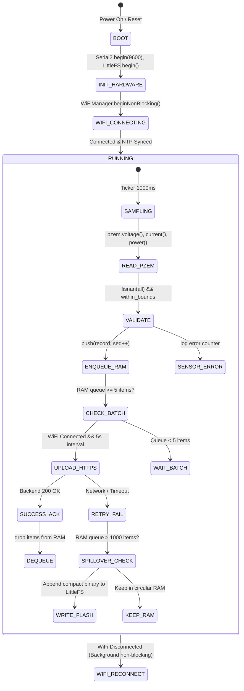

# Firmware Design: Modular ESP32 Architecture

Rancangan arsitektur firmware ESP32 WROOM-32D modular berbasis Arduino Framework / PlatformIO.

---

## 1. Modul-Modul Firmware

```text
firmware/
├── platformio.ini               # Konfigurasi board, env, flags, and library dependencies
├── src/
│   ├── main.cpp                 # Loop dan inisialisasi state machine
│   ├── config.cpp               # Muat konfigurasi dari NVS / Preferences
│   ├── pzem_manager.cpp         # Akuisisi UART2, validasi isnan, error tracking
│   ├── time_manager.cpp         # NTP synchronization, UTC epoch conversion
│   ├── data_queue.cpp           # Ring-buffer RAM & LittleFS emergency spillover
│   ├── telemetry_client.cpp     # WiFiClientSecure HTTPS batch uploader
│   └── wifi_manager.cpp         # State-machine non-blocking WiFi reconnection
└── include/
    ├── config.h
    ├── pzem_manager.h
    ├── time_manager.h
    ├── data_queue.h
    ├── telemetry_client.h
    └── wifi_manager.h
```

---

## 2. State Machine Firmware



---

## 3. Strategi Buffer Antrean Offline (*RAM Queue + Flash Fallback*)

- **RAM Circular Buffer**:
  Ukuran struct per record:
  ```cpp
  struct TelemetryRecord {
      uint32_t timestamp;
      uint32_t sequence;
      float voltage;
      float current;
      float powerFactor;
      float activePower;
      float energy;
      float frequency;
  }; // 32 bytes per record
  ```
  Kapasitas 1.000 records = $32.000\text{ bytes} \approx 32\text{ KB}$ RAM (sangat aman untuk ESP32 dengan 320 KB SRAM).
  Menyimpan hingga 1.000 detik = 16,6 menit data offline penuh tanpa menyentuh chip flash!
- **Emergency Flash Spillover**:
  Jika pemadaman internet $> 16$ menit dan RAM penuh:
  Tulis blok biner 1.000 record ke `/queue_spillover.bin` di LittleFS sekali saja, lalu kosongkan RAM. Saat Wi-Fi pulih, kuras (*drain*) `/queue_spillover.bin` terlebih dahulu sebelum menguras RAM.
  Dengan cara ini, flash memory hanya ditulis sekali setiap 16 menit pemadaman, bukan setiap detik, menjaga *flash wear* tetap nol dalam operasi normal.
